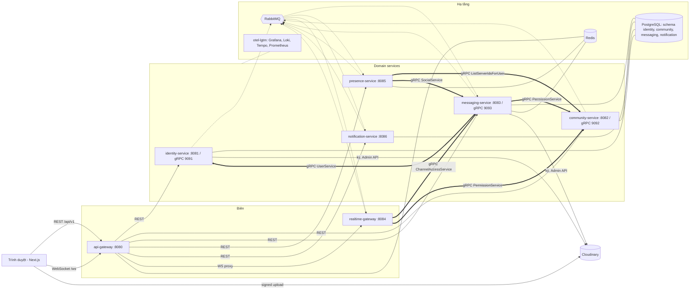

# nexus-backend

## Mô tả

<!-- TODO(người dùng): GIF demo, ảnh trace Tempo -->

Backend của Nexus, một nền tảng chat realtime kiểu Discord viết bằng Java 21 và Spring Boot 4.1, gồm 5 domain service, API gateway và WebSocket gateway nói chuyện với nhau bằng gRPC và RabbitMQ.

## Kiến trúc

Sơ đồ lấy từ [component-diagram.md](docs/03-diagrams/component-diagram.md): REST/WebSocket ở biên (nét liền), gRPC đồng bộ nội bộ (nét đậm), event qua RabbitMQ (nét đứt).





## gRPC ở đâu, event ở đâu, vì sao

Rút từ [architecture-overview.md §4](docs/02-architecture/architecture-overview.md#4-khi-nào-dùng-grpc-khi-nào-dùng-event). REST chỉ ở biên; gRPC khi caller cần câu trả lời ngay để quyết định tiếp (chỉ truy vấn); event khi producer báo điều đã xảy ra và không cần biết ai nghe (chấp nhận eventual consistency).

| Luồng | Kiểu | Caller → Callee / Producer → Consumer | Vì sao |
|------|------|----------------------------------------|--------|
| Gửi tin, đọc lịch sử, chữ ký đính kèm | gRPC | Messaging → Community `PermissionService/CheckChannelPermissions` | Phải biết có quyền trước khi lưu hay trả dữ liệu |
| Gửi lời mời kết bạn | gRPC | Messaging → Identity `UserService/GetUser` | Cần chắc user tồn tại |
| Client subscribe kênh / server realtime | gRPC | realtime-gateway → Messaging `ChannelAccessService/CheckChannelAccess`, Community `CheckServerMembership` | Quyết định cho hay không cho subscribe |
| Presence nạp bù tập server / tập bạn | gRPC | Presence → Community `ListServerIdsForUser`, Messaging `SocialService/ListFriendIds` | Cần dữ liệu đầy đủ ngay để áp quy tắc riêng tư |
| Tạo kênh | Event | Community `ChannelCreated` → Messaging (`channel_refs`) | Messaging không cần trả lời ngay, tự giữ bản chiếu |
| Member vào server, kick, ban, đổi role, overwrite | Event | Community `MemberJoined`, `MemberKicked`, `MemberBanned`, `MemberRolesChanged`, `ChannelPermissionsChanged` → Messaging, Notification, Presence, realtime-gateway | Lan truyền hậu quả, Community không cần biết ai nghe |
| Tin nhắn mới | Event | Messaging `MessageCreated` → realtime-gateway, Notification | Fan-out tới nhiều nơi, người gửi không chờ |
| Kết nối, ngắt WebSocket | Event | realtime-gateway `SessionConnected/Disconnected` → Presence | Presence tự tính trạng thái |
| Online, offline | Event | Presence `PresenceChanged` → realtime-gateway | Đẩy cho đúng bạn bè và người chung server |
| Đã đọc | Event | Notification `ReadStateUpdated` → realtime-gateway | Đồng bộ nhiều thiết bị |

## Chạy bằng một lệnh

Cần Docker và Docker Compose, `openssl` (sinh khóa JWT), `curl` và `jq` (script demo). Từ thư mục gốc repo:

```bash
cp .env.example .env && ./infra/scripts/gen-jwt-keys.sh && docker compose up -d --build --wait
```

Lệnh dựng Postgres, Redis, RabbitMQ và 7 service (project compose mặc định `nexus`, `realtime-gateway` 2 replica). Cổng Postgres/Redis trên host mặc định `5432`/`6379`; bị chiếm thì đặt `POSTGRES_PORT`, `REDIS_PORT` trước lệnh, ví dụ `POSTGRES_PORT=55432 docker compose up -d --build --wait`. Kiểm nhanh luồng mention, unread, đánh dấu đã đọc:

```bash
COMPOSE_PROJECT=nexus ./infra/scripts/demo-p8.sh
```

Chưa có frontend và chưa có tài khoản demo seed sẵn; gọi API qua gateway `http://127.0.0.1:8080`. Xóa sạch kể cả dữ liệu: `docker compose down -v`.

## CI

[](https://github.com/quocanh112233/nexus-backend/actions/workflows/identity-service.yml)
[](https://github.com/quocanh112233/nexus-backend/actions/workflows/community-service.yml)
[](https://github.com/quocanh112233/nexus-backend/actions/workflows/messaging-service.yml)
[](https://github.com/quocanh112233/nexus-backend/actions/workflows/realtime-gateway.yml)
[](https://github.com/quocanh112233/nexus-backend/actions/workflows/presence-service.yml)
[](https://github.com/quocanh112233/nexus-backend/actions/workflows/notification-service.yml)
[](https://github.com/quocanh112233/nexus-backend/actions/workflows/api-gateway.yml)
[](https://github.com/quocanh112233/nexus-backend/actions/workflows/proto.yml)
[](https://github.com/quocanh112233/nexus-backend/actions/workflows/repo-checks.yml)

Mỗi workflow service build, test (unit, Testcontainers IT, ArchUnit), build image và quét Trivy; `proto` chạy `buf lint` và `buf breaking`.

## Giao diện quản trị

| Giao diện | Địa chỉ | Ghi chú |
|----------|---------|---------|
| Swagger UI gộp qua gateway | `http://127.0.0.1:8080/swagger-ui.html` | Spec identity, community, messaging, notification |
| RabbitMQ Management | `http://127.0.0.1:15672` | Tài khoản `RABBITMQ_ADMIN_USER`/`RABBITMQ_ADMIN_PASSWORD` trong `.env`, vhost `nexus` |
| Grafana | `http://127.0.0.1:3001` | admin/admin; cần `OTEL_ENDPOINT=http://otel-lgtm:4318 docker compose --profile observability up -d --build --wait`; dashboard "Nexus overview" và 3 alert, xem [observability.md](docs/02-architecture/observability.md) |

## Số liệu đo

Đo trên một laptop (i7-1165G7, 8 luồng, 20 GB RAM) với stack compose riêng `nexus-perf` dưới giới hạn bộ nhớ container; chi tiết máy, lệnh và mọi lần chạy ở từng file trong [docs/perf/](docs/perf/README.md). Các phép đo bộ nhớ, lịch sử, gửi tin và fan-out WebSocket chạy với xuất OTLP tắt; các phép đo cache quyền, rate limit và độ bền chạy với OTLP bật, nên hai nhóm không so trực tiếp được.

| NFR | Ngưỡng | Số đo | Kết luận | Chi tiết |
|-----|-------|-------|----------|----------|
| NFR-001 gửi tin | p95 < 150 ms, 50 user | p95 61,33 ms (lần chậm hơn trong 2 lần; lần kia 24,365 ms), 0% lỗi | ĐẠT | [send-message.md](docs/perf/send-message.md) |
| NFR-002 tin tới client khác qua WebSocket | p95 < 1 s, giao ≥ 99% | lần chạy cuối: p95 493 ms nhưng tỉ lệ giao 0,66; 17/50 subscribe bị từ chối `DEPENDENCY_UNAVAILABLE`, 24/590 lần gửi trả 503 | KHÔNG ĐẠT, đang mở | [ws-fanout.md](docs/perf/ws-fanout.md) |
| NFR-003 lịch sử 1 triệu tin | p95 < 50 ms qua API | keyset 0,024-0,032 ms ở mọi độ sâu so với OFFSET 167,601 ms ở độ sâu 999 950 (DB); qua API p95 26,854 ms | ĐẠT | [history.md](docs/perf/history.md) |
| NFR-005 bộ nhớ | tổng ≤ 6 GB | 3.09 GiB tổng usage lúc rỗi sau demo P8 (12 container); dưới tải 3.73 đến 4.12 GiB. Nửa `-Xmx` ≤ 384 MB suy ra từ `MaxRAMPercentage=75` trên giới hạn 512m của Dockerfile, không đo | ĐẠT (tổng usage, rỗi và dưới tải) | [memory.md](docs/perf/memory.md), tải: [history.md](docs/perf/history.md), [send-message.md](docs/perf/send-message.md), [ws-fanout.md](docs/perf/ws-fanout.md), [permission-cache.md](docs/perf/permission-cache.md) |
| NFR-013 rate limit gửi tin | vượt 5 tin/5 s trả 429 | 20 tin liên tiếp: 6 × 201, 14 × 429 `Retry-After: 1`; user khác vẫn 201 | ĐẠT (route gửi tin) | [rate-limit.md](docs/perf/rate-limit.md) |
| Cache quyền Redis (P9 #4) | so sánh bật/tắt | gRPC call tới Community 5861 (tắt) so với 100 (bật) trong 2 phút; p95 42,853453 so với 41,513133 ms | chênh p95 nằm trong dao động giữa các lần | [permission-cache.md](docs/perf/permission-cache.md) |
| NFR-040 coverage | ≥ 70% dòng `domain` + `application` | 95,52% đến 100,00% ở 6 service (bảng dưới); api-gateway không có package `domain`/`application` | ĐẠT ngưỡng (đo cục bộ từ dòng lệnh); phần báo cáo trong CI chưa đạt, pom và CI chưa cấu hình JaCoCo | bảng dưới |

### Coverage `domain` + `application` (NFR-040)

Đo ngày 2026-11-17 trên commit dbebd3e bằng JaCoCo 0.8.14 gọi từ dòng lệnh (ba lần chạy liệt kê dưới bảng), gồm cả unit test và IT. Pom và CI chưa cấu hình JaCoCo nên CI chưa báo coverage. Số là `LINE_COVERED / (LINE_COVERED + LINE_MISSED)` trong `target/site/jacoco/jacoco.csv`, cộng mọi package có đoạn `.domain` hoặc `.application`.

| Service | Dòng phủ / tổng | domain + application line coverage |
|---------|-----------------|-------------------------------------|
| identity-service | 321 / 333 | 96,40% |
| community-service | 1175 / 1189 | 98,82% |
| messaging-service | 660 / 668 | 98,80% |
| realtime-gateway | 219 / 226 (chỉ có `application`) | 96,90% |
| presence-service | 114 / 114 | 100,00% |
| notification-service | 192 / 201 | 95,52% |
| api-gateway | không áp dụng (không có package `domain`/`application`) | không áp dụng |

Các lần chạy JaCoCo (prefix chung `./mvnw -B ... org.jacoco:jacoco-maven-plugin:0.8.14:prepare-agent verify org.jacoco:jacoco-maven-plugin:0.8.14:report`):

- Lần A, cả reactor, không cờ thêm: BUILD FAILURE ở presence-service (`GrpcFriendListLoaderTest.returnsFriendIds` lỗi `RelationUnavailable messaging call failed`, deadline 500 ms trong test), notification-service và api-gateway bị SKIPPED. Số của identity, community, messaging, realtime-gateway lấy từ lần này.
- Lần B, thêm `-rf :presence-service`: BUILD FAILURE vì không resolve được `nexus-common-grpc` (artifact không có trong repo local), không test nào chạy.
- Lần C, thêm `-Dmaven.test.failure.ignore=true -pl services/presence-service,services/notification-service,gateways/api-gateway -am`: BUILD SUCCESS, mọi test đạt (0 failure, 0 error, kể cả `GrpcFriendListLoaderTest` 2/2), nên cờ bỏ qua lỗi không che lỗi nào. Số của presence, notification, api-gateway lấy từ lần này.

## Thí nghiệm độ bền

Chi tiết lệnh, dòng thời gian và output: [resilience.md](docs/perf/resilience.md).

- Tắt Community: gửi tin trả `503 DEPENDENCY_UNAVAILABLE` sau 1,32 s (request đầu, JVM nguội) rồi 0,19 s; bật lại thì vẫn 503 thêm khoảng 16 s sau khi Community healthy rồi mới 201 (nguyên nhân chưa log được).
- Event trùng: publish lại đúng `MessageCreated` đã xử lý hai lần; lần publish 2 được giao và ack (bộ đếm queue 3 → 4, lần 1 không chụp bộ đếm trước) nhưng inbox bỏ qua: `mentionCount` giữ 1, `unread` giữ nguyên, `processed_event` vẫn 1 dòng.
- Kill consumer: kill `notification-service` lúc 05:37:10.65 và start lại lúc 05:37:40.94 giữa lúc k6 gửi tin; 2153 tin tạo từ lúc kill tới lúc container healthy lại (05:37:10.65 tới 05:37:56), queue dồn tới 2014 rồi về 0 khi lên lại; 5733/5733 event được xử lý, `mentionCount` 40 đúng bằng 40 tin mention đã gửi.

## Giới hạn đã biết

- NFR-002 không đạt ở lần chạy cuối: loạt SUBSCRIBE đầu tiên trên JVM nguội làm lời gọi kiểm quyền quá deadline 300/500 ms và có thể mở circuit breaker `community` dùng chung trong 10 s; một lần chạy lỗi trên stack đã nóng chưa giải thích được. realtime-gateway và messaging chưa log nguyên nhân gRPC nên chưa đo được mã lỗi (việc tiếp theo ghi trong [journal](docs/journal.md)).
- Kênh private chưa chặn metadata: notification chỉ biết membership server, không kiểm `VIEW_CHANNEL`, nên member không xem được kênh private vẫn thấy `channelId`, `lastMessageId`, `unread` qua `GET /read-states` và có thể nhận `MentionCreated` (không lộ nội dung tin).
- Backfill của notification-service giả định một instance (chạy nhiều instance cần khóa).
- Alert `DeadLetterNotEmpty` đã quan sát chuyển sang `firing` khi thử alert (stack đo hiện đã dừng): stack đo có 79 message trong `presence.realtime.events.dlq` (41) và `presence.community.events.dlq` (38) chết từ 2026-11-15, chưa điều tra, nằm trong volume RabbitMQ của project `nexus-perf` đang giữ lại để điều tra.
- Bộ nhớ sát giới hạn: `messaging-service` ở 504,5 MiB (ws-fanout.md) và 506,3 MiB (permission-cache.md) trên giới hạn 512 MiB và đã chạm `memory.max` 122 lần ([journal](docs/journal.md)); `otel-lgtm` ở 1015 MiB trên giới hạn 1 GiB (permission-cache.md). Thêm tải hoặc thêm series metric có thể gây OOM.
- JaCoCo chưa cấu hình trong pom và CI; số coverage ở trên đo cục bộ bằng lệnh dòng lệnh.

## Tài liệu

- ADR: [docs/00-overview/adr/](docs/00-overview/adr/README.md)
- Kiến trúc: [architecture-overview.md](docs/02-architecture/architecture-overview.md), [services.md](docs/02-architecture/services.md), [grpc-design.md](docs/02-architecture/grpc-design.md), [event-catalog.md](docs/02-architecture/event-catalog.md), [realtime-design.md](docs/02-architecture/realtime-design.md), [security.md](docs/02-architecture/security.md), [observability.md](docs/02-architecture/observability.md)
- Yêu cầu, sơ đồ, kế hoạch: [docs/01-requirements/](docs/01-requirements/), [docs/03-diagrams/](docs/03-diagrams/), [docs/05-plan/](docs/05-plan/)
- Nhật ký từng phase: [docs/journal.md](docs/journal.md)
- Toàn bộ tài liệu: [docs/](docs/README.md)

## Phát triển

### Yêu cầu

- JDK >= 21 (dự án biên dịch với `--release 21`; JDK 25 vẫn build được, image Docker dùng Temurin 21)
- Docker và Docker Compose
- Không cần cài Maven: dùng Maven wrapper `./mvnw`

### Lệnh thường dùng

| Mục đích | Lệnh |
|---------|------|
| Build + test toàn bộ | `./mvnw verify` |
| Kiểm tra format | `./mvnw spotless:check` |
| Format | `./mvnw spotless:apply` |

Thêm module mới: khai báo một dòng `<module>` trong `libs/pom.xml` hoặc `services/pom.xml`. Xem thêm [backend-structure.md](docs/04-project-structure/backend-structure.md#1-build-tool-maven-multi-module-p-03-adr-006).

### Hạ tầng local

| Mục đích | Lệnh |
|---------|------|
| Chuẩn bị lần đầu | `cp .env.example .env && ./infra/scripts/gen-jwt-keys.sh` |
| Chạy Postgres/Redis/RabbitMQ và 7 service | `docker compose up -d --build --wait` |
| Demo P1 (đăng ký, đăng nhập, refresh, reuse) | `./infra/scripts/demo-p1.sh` |
| Demo P2 (server, invite, join, rời; 6 request auth mỗi lần chạy) | `./infra/scripts/demo-p2.sh` |
| Demo P3 (role Mod, overwrite kênh, ban/gỡ ban; 6 request auth mỗi lần chạy) | `./infra/scripts/demo-p3.sh` |
| Demo P4 (nhắn tin, reaction, phân trang; 6 request auth mỗi lần chạy; thêm `DEMO_STOP_COMMUNITY=1 COMPOSE_PROJECT=<project>` để dừng Community và xem 503) | `./infra/scripts/demo-p4.sh` |
| Demo P7 (kết bạn, DM, presence bạn bè; cần stack đang chạy, `COMPOSE_PROJECT=<project>`; 6 request auth mỗi lần chạy) | `COMPOSE_PROJECT=<project> ./infra/scripts/demo-p7.sh` |
| Demo P8 (mention realtime, unread, đánh dấu đã đọc; cần stack đang chạy, `COMPOSE_PROJECT=<project>`; 6 request auth mỗi lần chạy) | `COMPOSE_PROJECT=<project> ./infra/scripts/demo-p8.sh` |
| Thêm Grafana/Loki/Tempo/Prometheus, bật OTLP | `OTEL_ENDPOINT=http://otel-lgtm:4318 docker compose --profile observability up -d --build --wait` |
| Đo hiệu năng (k6, stack `nexus-perf`) | xem [docs/perf/README.md](docs/perf/README.md) |
| Kiểm cách ly schema | `./infra/scripts/verify-isolation.sh` |
| Xóa sạch kể cả dữ liệu | `docker compose down -v` |

Các script demo cần `curl` và `jq` trên máy chạy.

Khóa JWT sinh bởi `gen-jwt-keys.sh` có quyền `644` để container non-root (uid 10001) đọc được bind mount; chỉ dùng cho local, không commit. Mọi cổng publish chỉ bind `127.0.0.1`. Cổng Postgres và Redis trên host mặc định `5432` và `6379`, đổi bằng `POSTGRES_PORT`, `REDIS_PORT` (inline hoặc trong `.env`) nếu bị chiếm.

`COOKIE_SECURE=false` trong `.env` chỉ dùng cho local chạy HTTP (cookie Secure qua HTTP thì curl không gửi lại); đặt `true` khi chạy sau HTTPS. `CORS_ALLOWED_ORIGINS` phải khớp chính xác Origin của trình duyệt.

### Cổng

Chỉ gateway :8080 được publish trong các service ứng dụng; các service khác chỉ truy cập được qua gateway (trong network compose) và cổng actuator của mọi service không publish.

| Service | Cổng app | Cổng actuator | Publish ra host |
|---------|---------|---------------|-----------------|
| api-gateway | 8080 | 8180 | `127.0.0.1:8080` |
| identity-service | 8081 (gRPC 9091) | 8181 | không |
| community-service | 8082 (gRPC 9092) | 8182 | không |
| messaging-service | 8083 (gRPC 9093) | 8183 | không |
| realtime-gateway (2 replica) | 8084 | 8184 | không |
| presence-service | 8085 | 8185 | không |
| notification-service | 8086 | 8186 | không |

Gateway giới hạn tần suất bằng Redis (NFR-013): `/api/v1/auth/**` khoảng 10 request/phút/IP, API có token khoảng 100 request/phút/user, xem trước invite khoảng 30 request/phút/IP, gửi tin nhắn 5 tin/5 giây/user (bền vững 60/phút); vượt mức trả 429. `infra/scripts/demo-p1.sh` tốn 4 request auth và `demo-p2.sh` và `demo-p3.sh` tốn 6 mỗi lần chạy; hai lần chạy liên tiếp trong 1 phút (6 + 6 > 10, kể cả xen kẽ `demo-p2.sh` và `demo-p3.sh`) sẽ gặp 429, chờ 1 phút rồi chạy lại.

Gateway định tuyến `/api/v1/auth/**`, `/api/v1/users/**` tới identity, `/api/v1/servers/**`, `/api/v1/invites/**` tới community, `/api/v1/channels/**`, `/api/v1/attachments/**` tới messaging, `/api/v1/read-states/**` tới notification và `/ws` tới realtime-gateway; danh sách endpoint đầy đủ ở Swagger UI và [services.md](docs/02-architecture/services.md). Biến `CLOUDINARY_*` để trống thì service vẫn chạy nhưng upload avatar và đính kèm chưa dùng được.
