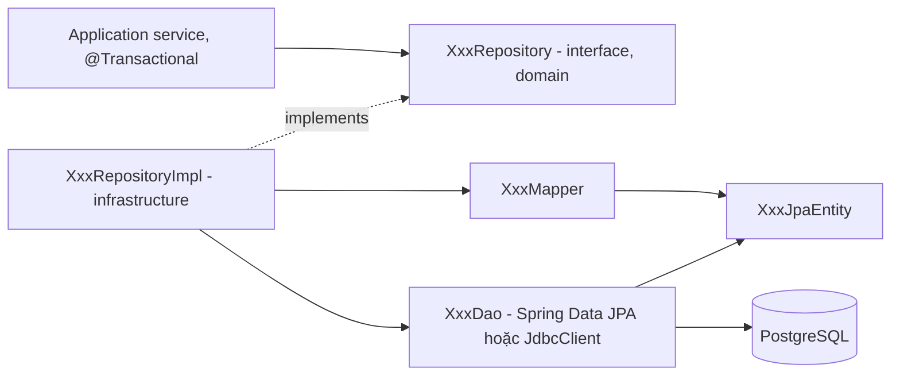

# ADR-009: Thêm lớp DAO + mapper tách domain khỏi persistence

Ghi lại lý do mỗi service có lớp DAO riêng giữa Repository của domain và database.

- **Trạng thái:** Accepted — người dùng chọn (D-21)

## Bối cảnh

- Cách ngắn nhất trong Spring là gắn `@Entity` thẳng lên aggregate và cho `interface MessageRepository extends JpaRepository<Message, UUID>` làm luôn repository domain. Khi đó domain phụ thuộc JPA: phải có constructor rỗng, setter hoặc field không `final`, lazy loading lẫn vào logic nghiệp vụ.
- Mục tiêu học DDD và luật "domain thuần Java" (ArchUnit) không cho phép điều đó.

## Quyết định

- **Domain** chỉ có `XxxRepository` (interface, ngôn ngữ nghiệp vụ, nhận/trả aggregate).
- **Infrastructure/persistence** có: `XxxJpaEntity` (ánh xạ bảng), `XxxDao` (truy cập dữ liệu), `XxxMapper` (chuyển JPA entity ↔ aggregate), `XxxRepositoryImpl` (hiện thực interface bằng DAO + mapper).
- Transaction đặt ở application service. Outbox/inbox dùng `OutboxEventDao`, `ProcessedEventDao` trong cùng transaction.
- Chi tiết, quy tắc và cách test: [backend-structure.md](../../04-project-structure/backend-structure.md#31-lớp-persistence-repository--repositoryimpl--dao-adr-009-người-dùng-đã-chọn).

## Hệ quả

- (+) Domain không biết JPA: aggregate có field `final`, không setter, test không cần DB.
- (+) Đổi cách lưu (JPA sang `JdbcClient`, thêm cache) chỉ sửa `infrastructure`.
- (+) Mô hình bảng (tối ưu cho query) và mô hình domain (tối ưu cho bất biến) tiến hóa độc lập.
- (-) Thêm code mapping: mỗi aggregate thêm 3-4 class (`JpaEntity`, `Dao`, `Mapper`, `RepositoryImpl`). Chấp nhận; mapper viết tay (không Lombok, không MapStruct — giữ code tường minh).
- (-) Phải tái tạo aggregate từ dữ liệu: aggregate cần factory `rehydrate(...)` riêng, không chạy lại kiểm tra "tạo mới" hay sinh event.
- (-) Mất một số tiện ích JPA (dirty checking trên aggregate): RepositoryImpl phải `save` tường minh. Đây cũng là điều tốt — ghi DB lúc nào là rõ ràng.
