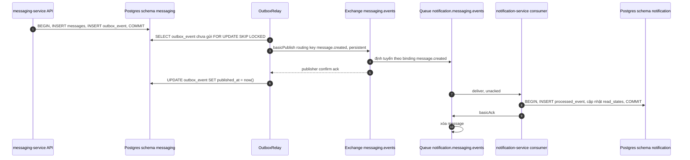
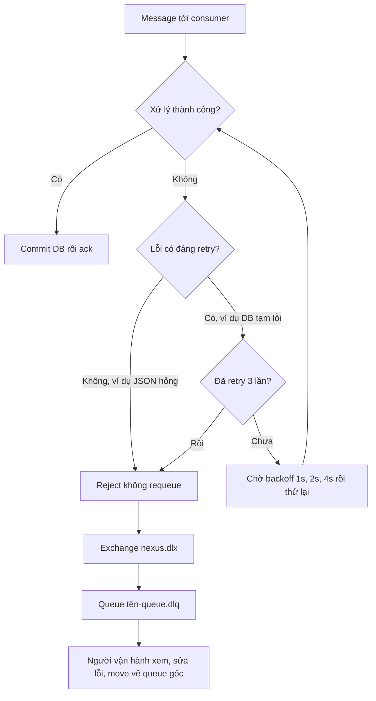
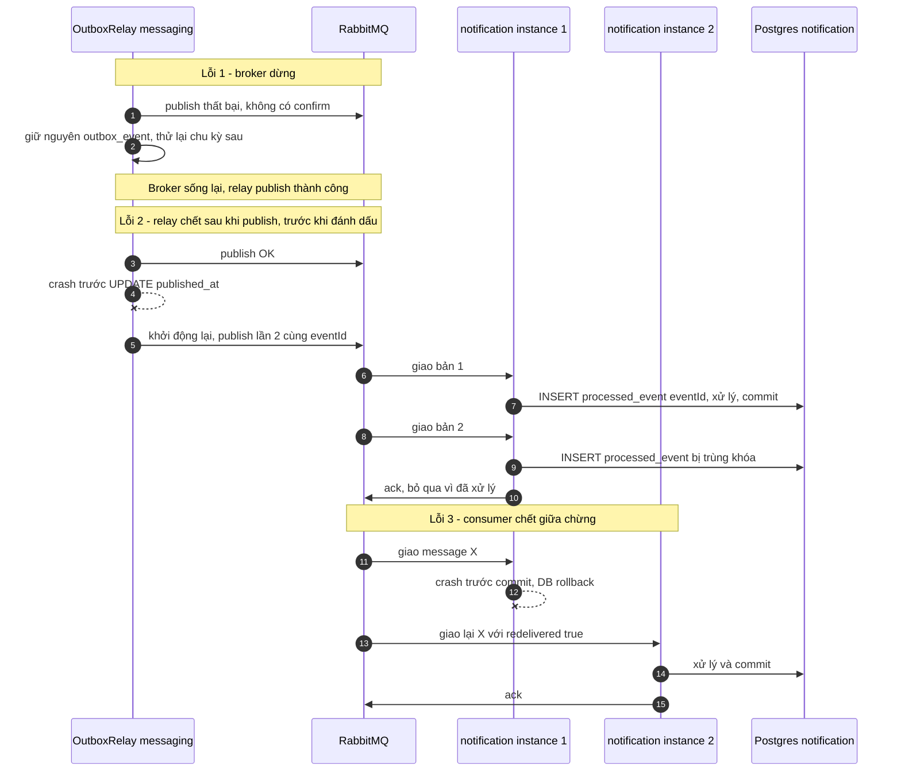

# Message queue: hoạt động thế nào (deep dive)

File này giải thích cơ chế message queue trong Nexus từ gốc: producer, broker, exchange/queue/binding (RabbitMQ), ack, retry, dead letter, ordering, idempotency, outbox, at-least-once vs exactly-once — kèm sơ đồ luồng thường và luồng lỗi. Tên exchange/queue khớp [event-catalog.md](event-catalog.md).

## 1. Vì sao cần message queue

Khi Messaging lưu tin nhắn, có 2 việc phụ: đẩy realtime và cập nhật unread. Nếu Messaging gọi trực tiếp từng nơi: (a) Notification chết → gửi tin lỗi; (b) thêm consumer mới phải sửa Messaging. Message queue tách **thời gian** (consumer có thể đang chết, xử lý sau) và **không gian** (producer không biết consumer là ai).

## 2. Các thành phần (RabbitMQ)

| Khái niệm | Là gì | Trong Nexus |
|----------|-------|-------------|
| Producer | Ứng dụng gửi message | `OutboxRelay` trong mỗi service |
| Broker | Server nhận, định tuyến, lưu message | RabbitMQ (container `rabbitmq`, vhost `nexus`) |
| Connection / Channel | 1 TCP connection, nhiều channel logic bên trong | Spring AMQP `CachingConnectionFactory` |
| Exchange | "Bưu điện": nhận message và định tuyến theo luật, **không lưu** | `messaging.events` (topic) |
| Routing key | Nhãn trên message | `message.created` |
| Queue | Hàng đợi **lưu** message tới khi consumer ack | `notification.messaging.events` |
| Binding | Luật nối exchange → queue theo pattern | `message.created`, `#`, `session.*` |
| Consumer | Ứng dụng đọc từ queue | `@RabbitListener` trong `interfaces/messaging/` |
| Competing consumers | Nhiều instance cùng đọc một queue → mỗi message chỉ tới **một** instance | 2 instance notification chia tải |
| Fan-out | Một message tới **nhiều queue** (mỗi queue một bản) | `MessageCreated` → queue của notification + queue mỗi instance realtime-gateway |
| Quorum queue | Queue nhân bản theo Raft, an toàn dữ liệu | Mọi queue durable của service |
| Prefetch | Số message tối đa đã giao mà chưa ack cho một consumer | 20 |

Topic exchange khớp routing key theo pattern: `*` = đúng một từ, `#` = 0 hoặc nhiều từ. Ví dụ binding `session.*` khớp `session.connected`, không khớp `gateway.heartbeat`.

## 3. Luồng một message đi qua hệ thống (đường thường)



Ba "điểm bàn giao" an toàn: (1) dữ liệu + outbox cùng commit; (2) broker xác nhận (publisher confirm) rồi mới đánh dấu đã gửi; (3) consumer commit DB rồi mới ack.

## 4. Ack, nack, requeue

| Hành động consumer | Kết quả |
|--------------------|---------|
| `ack` | Broker xóa message |
| `nack/reject` với `requeue=true` | Đưa lại queue → **nguy cơ vòng lặp vô hạn** nếu lỗi vĩnh viễn (poison message) |
| `nack/reject` với `requeue=false` | Đi tới dead-letter exchange (nếu cấu hình) |
| Consumer chết trước khi ack | Broker giao lại cho consumer khác (`redelivered=true`) |

Nexus dùng `acknowledge-mode: auto` của Spring AMQP: listener return bình thường → ack; ném exception → retry theo mục 5, hết lượt → reject không requeue → DLQ.

## 5. Retry và dead letter

| Bước | Cấu hình |
|------|---------|
| Retry trong consumer | 3 lần, backoff 1 s → 2 s → 4 s (Spring AMQP `RetryInterceptorBuilder.stateless()`) |
| Lỗi không đáng retry | `IllegalArgumentException`, lỗi parse JSON → vào DLQ ngay (`AmqpRejectAndDontRequeueException`) |
| Dead letter | Mỗi queue có `x-dead-letter-exchange = nexus.dlx`, `x-dead-letter-routing-key = <queue>.dlq` |
| DLQ | `<queue>.dlq`, quorum, không có consumer tự động |
| Replay | Dùng Management UI "Move messages" (shovel) từ DLQ về queue gốc sau khi sửa lỗi; hoặc endpoint admin nội bộ (tùy chọn) |
| Cảnh báo | Metric `rabbitmq_queue_messages{queue=~".*dlq"} > 0` hiển thị đỏ trên Grafana |



## 6. Tình huống lỗi và cách hệ thống chịu đựng



| Tình huống | Điều gì xảy ra | Cơ chế bảo vệ |
|-----------|----------------|---------------|
| Broker chết lúc service ghi dữ liệu | Request người dùng vẫn thành công; event nằm trong outbox | Outbox |
| Relay publish xong nhưng chết trước khi đánh dấu | Event phát 2 lần | Inbox (idempotent consumer) |
| Consumer chết trước khi ack | Message giao lại | Ack thủ công sau commit |
| Consumer lỗi vĩnh viễn với 1 message | Không chặn queue mãi | Retry giới hạn + DLQ |
| Consumer chậm, queue dài ra | Producer không bị ảnh hưởng | Queue là buffer; scale thêm instance (competing consumers) |

## 7. Ordering (thứ tự)

- RabbitMQ giữ thứ tự **trong một queue** khi giao cho **một** consumer. Có retry, prefetch > 1, hoặc nhiều consumer → thứ tự **không** còn đảm bảo.
- Outbox relay publish theo thứ tự `id` (UUIDv7) của bảng outbox.
- Nexus **không dựa vào thứ tự**, thiết kế consumer chịu được đảo thứ tự:

| Consumer | Kỹ thuật |
|---------|---------|
| notification `channel_activity` | `UPDATE ... SET last_message_id = GREATEST(last_message_id, :id)` |
| notification `read_states` | `last_read_message_id` chỉ tăng |
| realtime client | So `version` của tin: bỏ `MessageEdited` có `version` ≤ bản đang giữ; `MessageDeleted` thắng mọi edit |
| messaging `channel_refs` | `ChannelDeleted` tới trước `ChannelCreated` → ghi tombstone `deleted_at`, `ChannelCreated` sau đó không hồi sinh |

## 8. Idempotency, outbox, at-least-once vs exactly-once

| Mức đảm bảo | Ý nghĩa | Nexus |
|------------|---------|-------|
| At-most-once | Có thể mất, không trùng | Chỉ `TypingStarted` (mất cũng không sao) |
| At-least-once | Không mất, có thể trùng | **Mặc định** cho mọi event nghiệp vụ |
| Exactly-once | Không mất, không trùng | Không có ở mức mạng; đạt **hiệu quả exactly-once** = at-least-once + consumer idempotent |

**Outbox pattern** (producer):

| Bước | Chi tiết |
|------|---------|
| 1 | Use case (`@Transactional`) lưu aggregate qua Repository + gọi `DomainEventPublisher` → `OutboxWriter` ghi `outbox_event` qua `OutboxEventDao` **trong cùng transaction** |
| 2 | `OutboxRelay` (`@Scheduled` mỗi 500 ms) dùng `OutboxEventDao` đọc tối đa 100 dòng `published_at IS NULL ORDER BY id FOR UPDATE SKIP LOCKED` → nhiều instance chạy song song không gửi trùng cùng lúc |
| 3 | Publish với publisher confirm; confirm OK → `published_at = now()` |
| 4 | Job dọn dòng đã gửi > 7 ngày |

**Inbox pattern** (consumer) — `InboxGuard` chạy câu lệnh dưới qua `ProcessedEventDao`:

```sql
-- trong cùng transaction với xử lý nghiệp vụ
INSERT INTO processed_event (event_id, consumer, processed_at)
VALUES (:eventId, :consumer, now())
ON CONFLICT DO NOTHING;
-- 0 dòng được insert → event đã xử lý → bỏ qua, ack
```

Ngoài inbox, thao tác nghiệp vụ cũng nên tự idempotent (`ON CONFLICT DO NOTHING`, `GREATEST`) — hai lớp bảo vệ.

**Vì sao không publish thẳng trong transaction?** Publish rồi transaction rollback → event "ma". Commit rồi publish nhưng crash giữa hai bước → mất event. Outbox loại bỏ cả hai.

## 9. So sánh Kafka vs RabbitMQ

| Tiêu chí | RabbitMQ | Kafka |
|---------|----------|-------|
| Mô hình | Broker định tuyến (exchange → queue), message bị xóa sau ack | Log phân tán, message giữ theo thời gian, consumer tự giữ offset |
| Đơn vị song song | Nhiều consumer trên một queue | Partition; số consumer trong group ≤ số partition |
| Thứ tự | Trong một queue + một consumer | Trong một partition (theo key) — mạnh hơn |
| Replay | Không (trừ Streams) | Có, tua lại offset — dựng projection mới dễ |
| Routing | Rất linh hoạt (topic/direct/fanout/headers) | Theo topic; lọc phía consumer |
| Retry / DLQ | Có sẵn (DLX) | Tự xây (retry topic, DLT) |
| Chạy local | 1 container nhẹ, UI trực quan | 1 container KRaft; cần thêm UI (Kafdrop/AKHQ) |
| Thông lượng | Đủ cho hàng chục nghìn msg/s | Rất cao |
| Đường cong học | Thoải hơn | Dốc hơn (partition, rebalance, offset commit) |

**Lựa chọn đề xuất: RabbitMQ** (P-01, [ADR-001](../00-overview/adr/ADR-001-message-broker.md)) — dễ chạy local, thấy rõ ack/DLQ trên UI, phù hợp trình độ hiện tại. Kafka là "mở rộng tùy chọn" sau MVP ([learning-path.md](../05-plan/learning-path.md#mở-rộng-tùy-chọn)): vì outbox + envelope + inbox độc lập với broker, chỉ cần thay lớp `infrastructure/messaging`.

## 10. Cấu hình tham chiếu (Spring AMQP)

| Thuộc tính | Giá trị |
|-----------|---------|
| `spring.rabbitmq.publisher-confirm-type` | `correlated` |
| `spring.rabbitmq.publisher-returns` | `true` (+ `mandatory`) — message không khớp binding nào sẽ được báo lại, log warn |
| `spring.rabbitmq.listener.simple.prefetch` | `20` |
| `spring.rabbitmq.listener.simple.concurrency` | `1-4` |
| `spring.rabbitmq.listener.simple.default-requeue-rejected` | `false` |
| Message converter | `Jackson2JsonMessageConverter` |
| Delivery mode | `PERSISTENT` (trừ `TypingStarted`: non-persistent, `expiration=5000`) |
