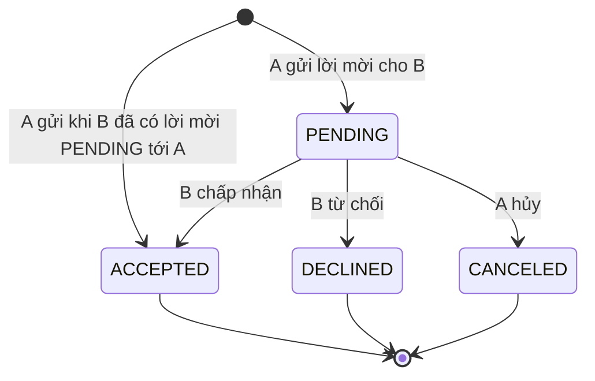
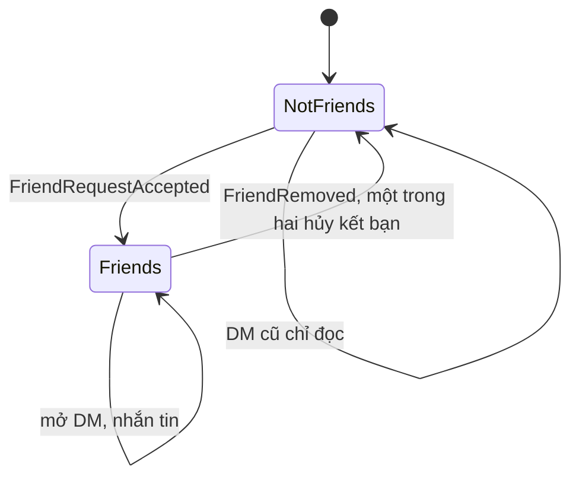

# Activity: vòng đời lời mời kết bạn

File này mô tả máy trạng thái của aggregate `FriendRequest` và quan hệ `Friendship` (FR-070..FR-074). Đây là ví dụ DDD điển hình: aggregate tự bảo vệ bất biến chuyển trạng thái.

## 1. FriendRequest

| Chuyển | Ai được làm | Event | Lỗi nếu sai |
|-------|------------|-------|-------------|
| tạo → PENDING | requester | `FriendRequestSent` | `409 FRIEND_REQUEST_EXISTS`, `409 ALREADY_FRIENDS`, `400` nếu tự mời mình |
| PENDING → ACCEPTED | addressee | `FriendRequestAccepted` | `403` nếu không phải addressee; `409 VERSION_CONFLICT` nếu đã đổi trạng thái |
| PENDING → DECLINED | addressee | `FriendRequestDeclined` | như trên |
| PENDING → CANCELED | requester | `FriendRequestCanceled` | như trên |

Trạng thái kết thúc là bất biến; muốn kết bạn lại thì tạo lời mời mới.

## 2. Friendship

