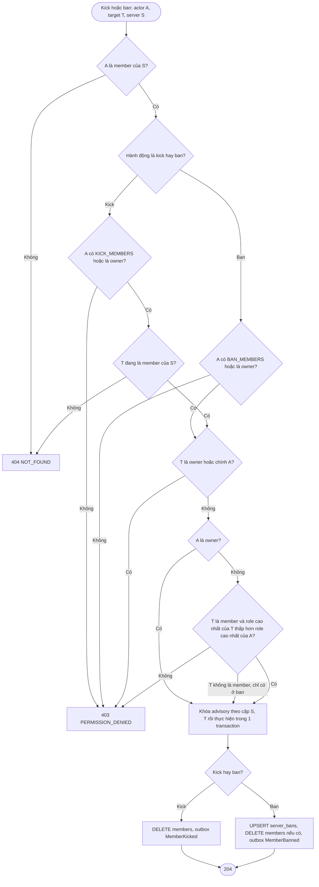

# Activity: kiểm tra trước khi kick / ban

File này mô tả các kiểm tra của Community khi nhận yêu cầu kick hoặc ban (FR-036, FR-037) — áp dụng luật thứ bậc trong [permission-model.md](../01-requirements/permission-model.md#2-role).

