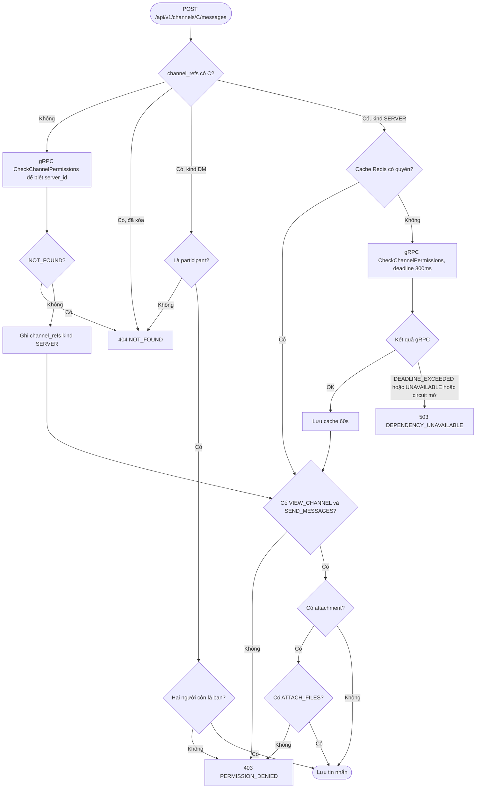
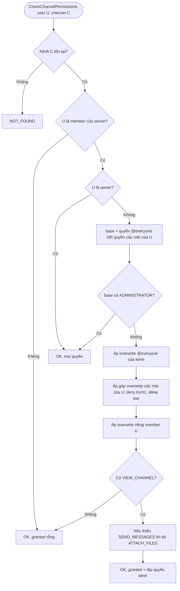

# Activity: kiểm tra permission khi gửi tin

File này mô tả quyết định ở Messaging khi nhận yêu cầu gửi tin (WF-05) và thuật toán tính quyền ở Community ([permission-model.md](../01-requirements/permission-model.md)).

## 1. Phía Messaging

## 2. Phía Community: tính quyền hiệu lực

