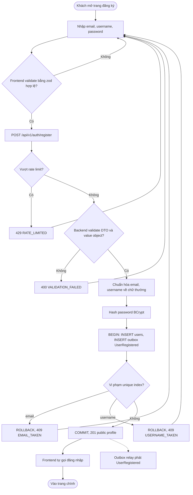

# Activity: luồng đăng ký

File này mô tả các bước và nhánh lỗi của luồng đăng ký (WF-01, FR-001).

Ghi chú: không kiểm tra trùng bằng `SELECT` trước rồi mới `INSERT` (có race condition); dựa vào **unique index** và dịch lỗi vi phạm thành `409`.
