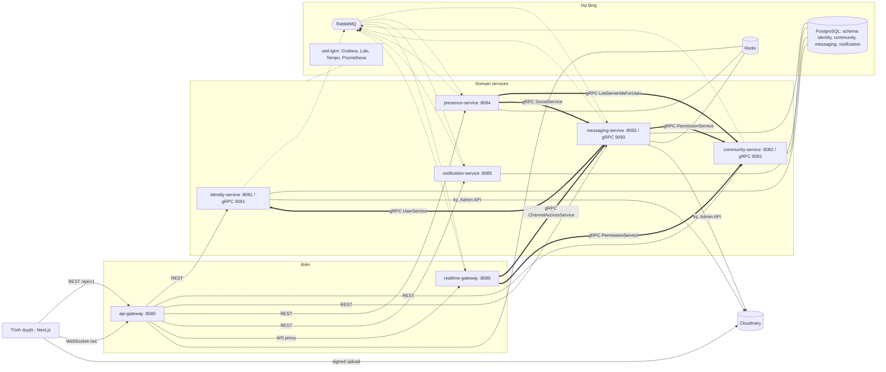
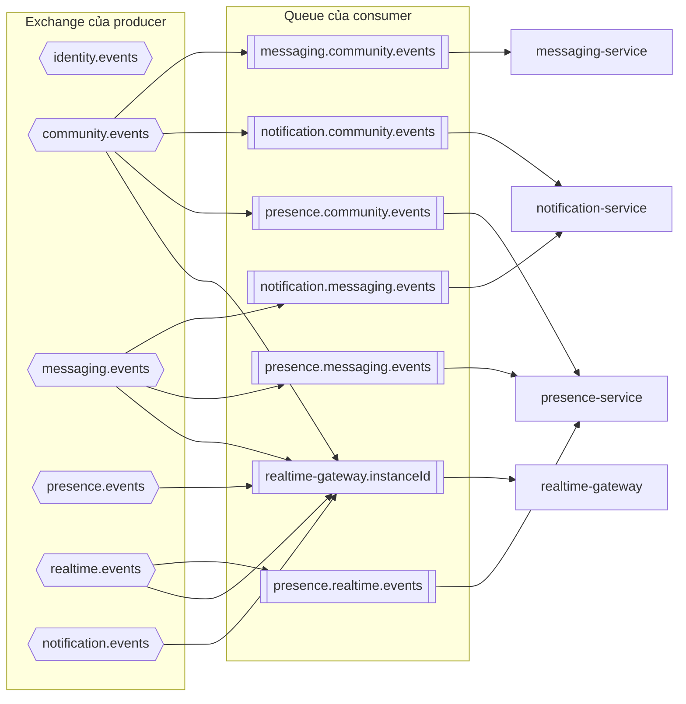
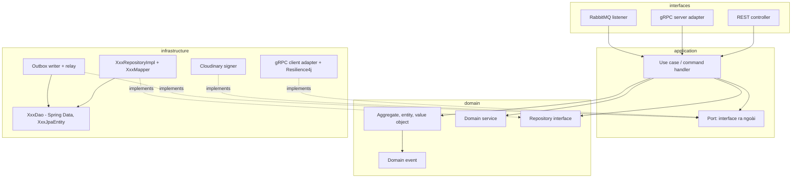

# Component diagram

File này thể hiện các thành phần runtime và ba kiểu kết nối: REST/WebSocket ở biên (nét liền), gRPC đồng bộ nội bộ (nét đậm), event qua RabbitMQ (nét đứt). Mô tả: [architecture-overview.md](../02-architecture/architecture-overview.md).

## 1. Toàn cảnh

## 2. Luồng event (exchange → consumer)

## 3. Cấu trúc bên trong một service (hexagonal + DDD)

Mũi tên phụ thuộc luôn hướng vào `domain`; DAO và JPA entity chỉ nằm trong `infrastructure` ([ADR-009](../00-overview/adr/ADR-009-dao-layer.md)); `domain` không phụ thuộc Spring, JPA hay class sinh từ proto (ArchUnit cưỡng chế).
