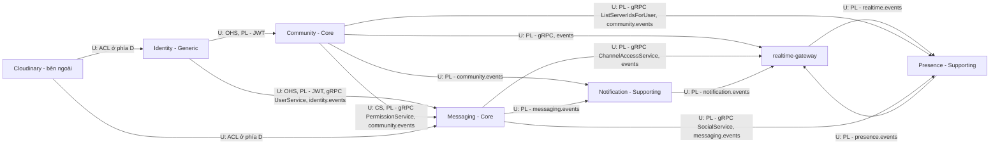

# Context map

File này vẽ quan hệ DDD giữa các bounded context. Bảng giải thích: [bounded-contexts-and-context-map.md](../02-architecture/bounded-contexts-and-context-map.md). Ký hiệu nhãn: U = upstream, D = downstream, OHS = Open Host Service, PL = Published Language, CS = Customer-Supplier, ACL = Anti-corruption layer.

