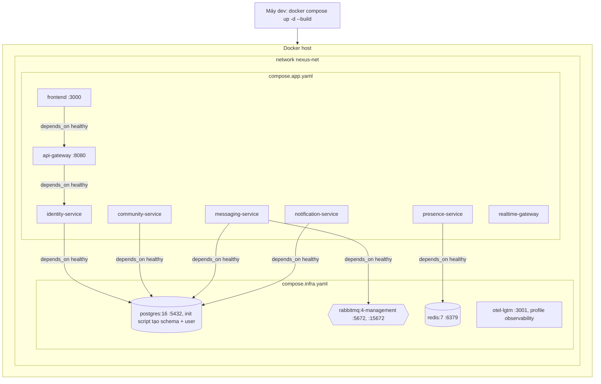
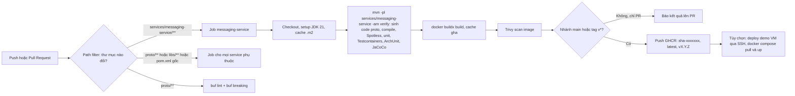
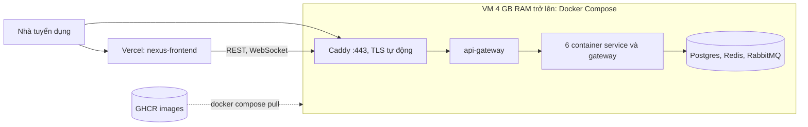

# Deployment diagram

File này mô tả cách triển khai: Docker Compose ở local, pipeline CI/CD GitHub Actions → GHCR, và bản demo công khai trên 1 VM. Chi tiết: [infra-structure.md](../04-project-structure/infra-structure.md), [devops-plan.md](../05-plan/devops-plan.md).

## 1. Docker Compose local

Chỉ `api-gateway :8080`, `frontend :3000`, UI RabbitMQ `:15672`, Grafana `:3001` (và Postgres/Redis cho debug) được publish ra host. Cổng gRPC không publish.

## 2. Pipeline CI/CD

## 3. Demo công khai (P-28)

