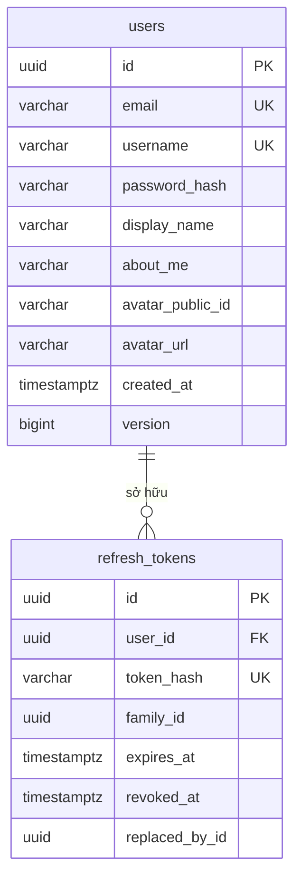
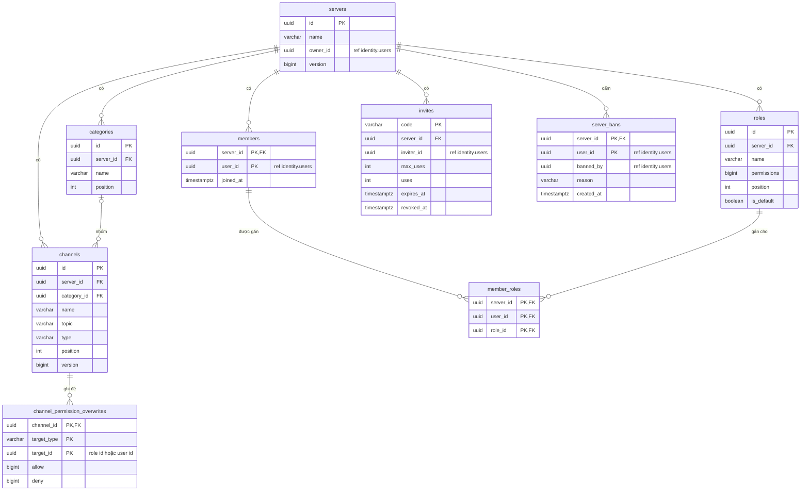
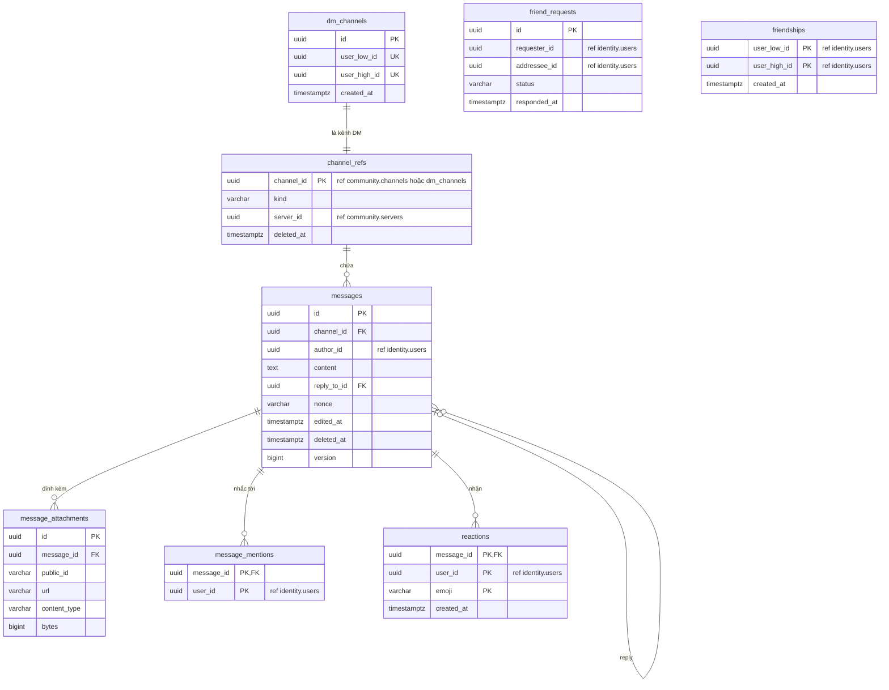
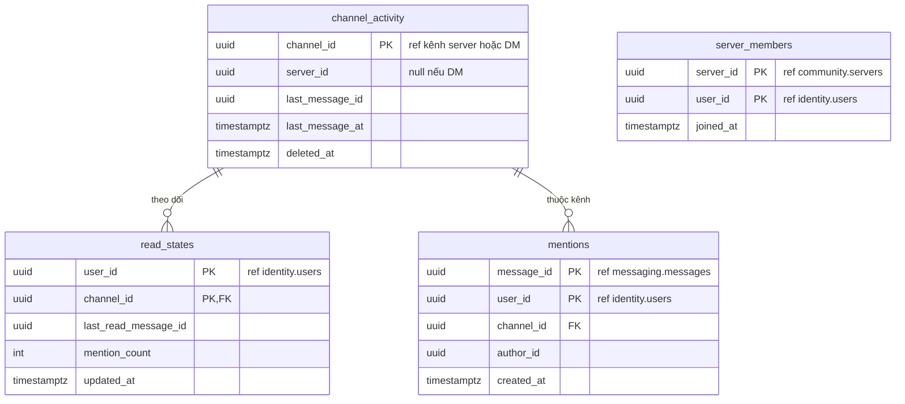

# ERD theo từng schema

File này vẽ ERD cho từng schema bằng `erDiagram`. Mỗi schema là một sơ đồ riêng vì **không có quan hệ chéo schema**; cột tham chiếu sang service khác ghi chú `ref ...` và không có foreign key. Mô tả cột/index: [data-model.md](../02-architecture/data-model.md). Bảng `outbox_event`, `processed_event` có ở mọi schema nên không vẽ lại.

## 1. Schema `identity`

## 2. Schema `community`

## 3. Schema `messaging`

Ghi chú: `messages.channel_id` → `channel_refs` là FK **trong cùng schema** (hợp lệ); `channel_refs` lại là bản chiếu của dữ liệu Community. `dm_channels.id = channel_refs.channel_id` khi `kind = DM`.

## 4. Schema `notification`

## 5. Presence

Không có schema Postgres — chỉ Redis, xem [data-model.md](../02-architecture/data-model.md#5-presence-redis).
