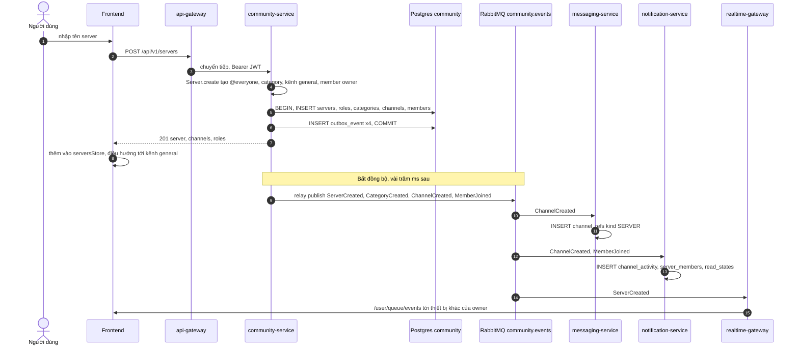

# Sequence: tạo server

File này mô tả tạo server: một transaction trong Community (dữ liệu + outbox), sau đó event lan tới các service khác (WF-03, FR-020).

Điểm học: nếu gửi tin vào kênh `general` **ngay** sau khi tạo mà `channel_refs` chưa kịp có → Messaging fallback gọi gRPC `CheckChannelPermissions` (trả `server_id`) rồi tự ghi `channel_refs`. Đây là cách xử lý eventual consistency "đọc-sau-ghi" giữa hai service.
