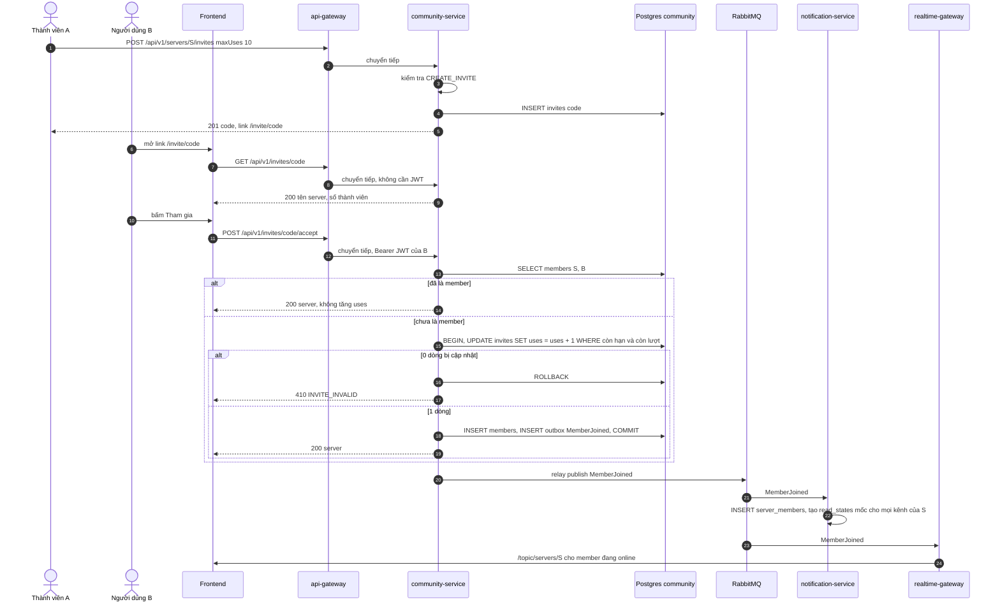

# Sequence: tham gia server qua invite

File này mô tả tạo invite, xem trước và tham gia server, gồm xử lý đồng thời khi nhiều người dùng cùng một invite có giới hạn lượt (WF-04, FR-026..FR-028).

Điểm học về concurrency: `UPDATE ... WHERE uses < max_uses` là thao tác nguyên tử ở mức dòng → không cần lock ứng dụng. PK `(server_id, user_id)` chặn insert trùng nếu B bấm hai lần đồng thời (bắt `DuplicateKeyException` → coi như đã là member).
