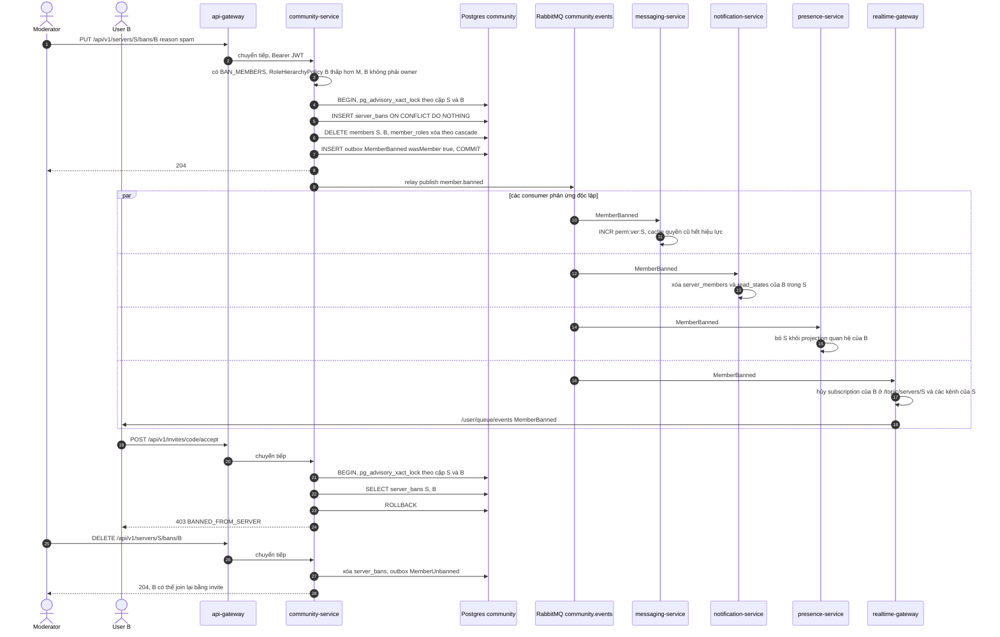

# Sequence: kick, ban và join lại bị từ chối

File này mô tả ban một member (kèm lý do), lan truyền event tới các service, rồi người bị ban thử join lại qua invite (WF-12, FR-036, FR-037, FR-039). Kick giống ban nhưng không ghi `server_bans`, phát `MemberKicked`, và người bị kick join lại được.

