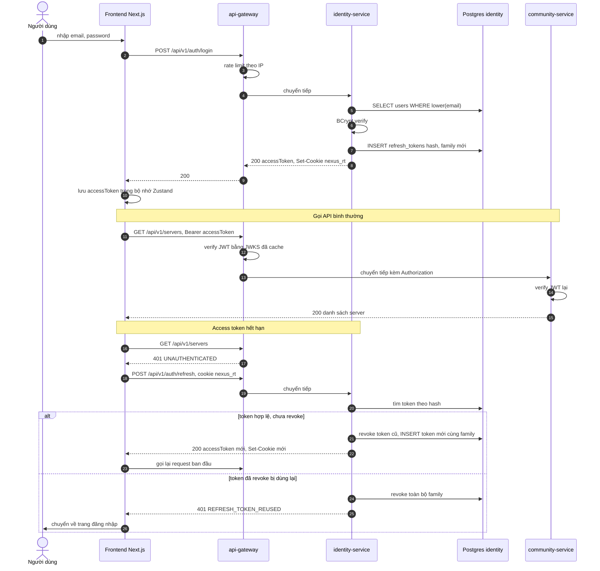

# Sequence: đăng nhập và làm mới token

File này mô tả luồng đăng nhập, gọi API bằng access token, refresh token rotation và phát hiện reuse (WF-02, FR-002..FR-004).

Ghi chú: frontend dùng một promise refresh chung để nhiều request 401 cùng lúc chỉ gọi refresh **một lần** (tránh tự kích hoạt reuse detection).
