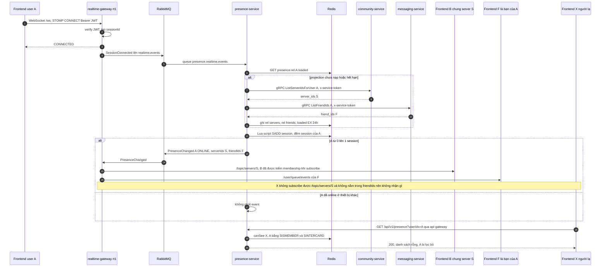
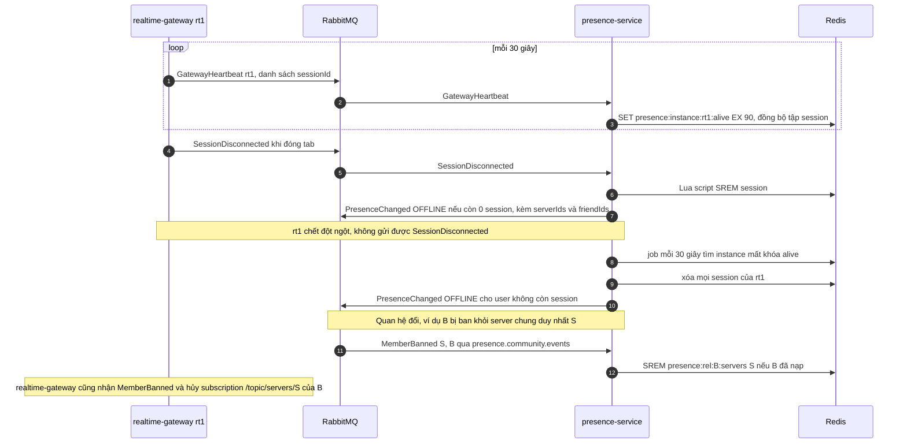

# Sequence: cập nhật presence (có quy tắc riêng tư)

File này mô tả cách kết nối WebSocket dẫn tới trạng thái online/offline, chỉ giao cho **bạn bè và người chung server** (D-18), gồm nạp bù projection quan hệ và trường hợp gateway chết đột ngột (WF-10, FR-080, FR-081, FR-083). Chi tiết: [realtime-design.md](../02-architecture/realtime-design.md#6-presence-và-quyền-riêng-tư).

## 1. Online, giao đúng người

## 2. Offline, heartbeat và quan hệ đổi

