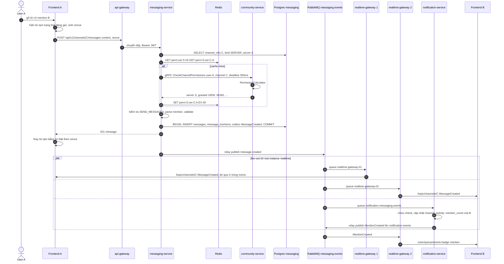
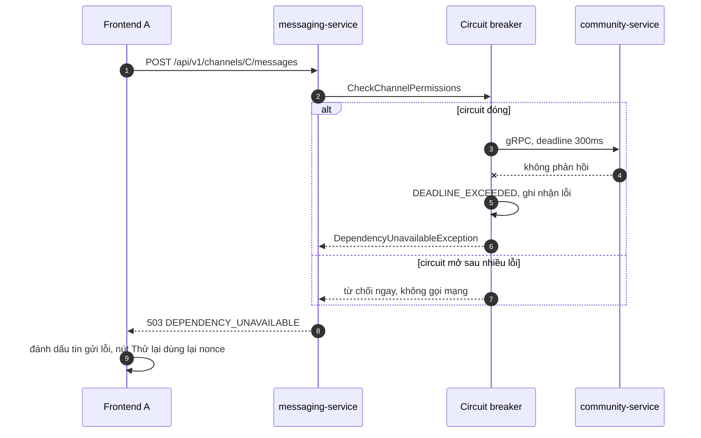

# Sequence: gửi tin nhắn realtime qua nhiều service

File này mô tả luồng quan trọng nhất của Nexus: REST vào Messaging, gRPC kiểm tra quyền ở Community, outbox → RabbitMQ → realtime-gateway (nhiều instance) và Notification (WF-05, FR-050, FR-056, FR-059).

## 1. Luồng thường

## 2. Luồng lỗi: Community không trả lời

Nếu quyền đã có trong cache Redis, tin vẫn gửi được dù Community đang chết — đây là lợi ích của cache trong việc giảm phụ thuộc runtime.
