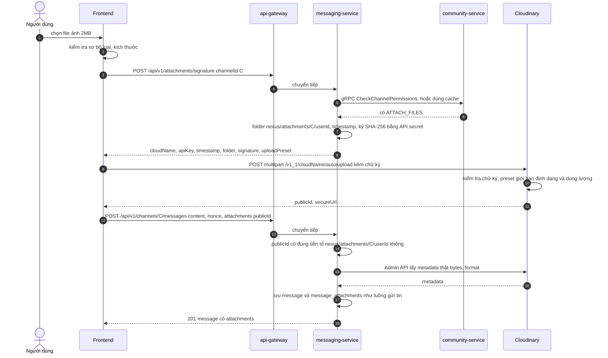

# Sequence: upload file qua Cloudinary signed upload

File này mô tả cách frontend upload thẳng lên Cloudinary bằng chữ ký do backend cấp, rồi gửi tin nhắn có đính kèm (WF-09, FR-058, FR-101, FR-102). Avatar giống hệt nhưng gọi Identity (`/api/v1/users/me/avatar/signature`, `PUT /api/v1/users/me/avatar`).

API secret không bao giờ rời backend. Lỗi tại bước kiểm tra tiền tố → `400 VALIDATION_FAILED`.
