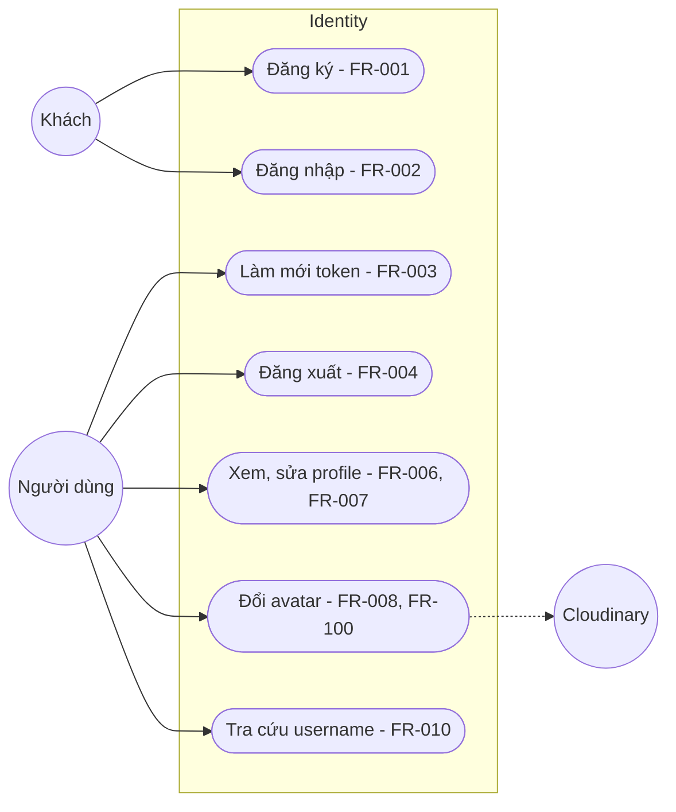
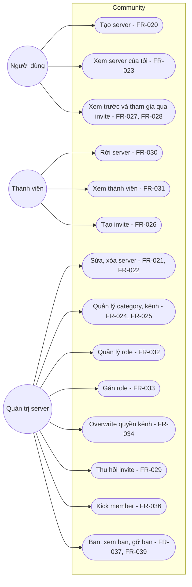
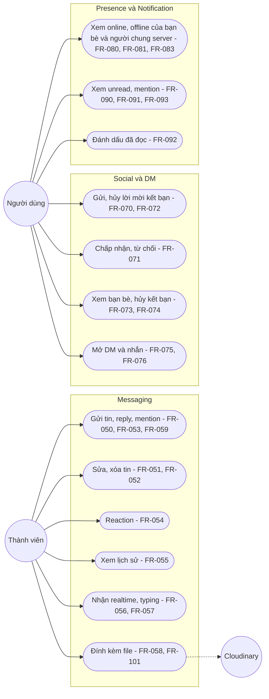

# Use case diagram

File này thể hiện tác nhân và use case theo module. Mermaid không có use case diagram chuẩn UML nên dùng `flowchart` mô phỏng: hình tròn kép = tác nhân, hình viên thuốc = use case, khung = module (bounded context). Mã FR trong ngoặc vuông.

## 1. Tác nhân

| Tác nhân | Mô tả |
|---------|-------|
| Khách | Chưa đăng nhập |
| Người dùng | Đã đăng nhập |
| Thành viên | Người dùng trong một server |
| Quản trị server | Thành viên có quyền quản lý (MANAGE_*), hoặc owner |
| Cloudinary | Hệ thống ngoài lưu file |

## 2. Identity

## 3. Community

## 4. Messaging, Social, Presence, Notification

