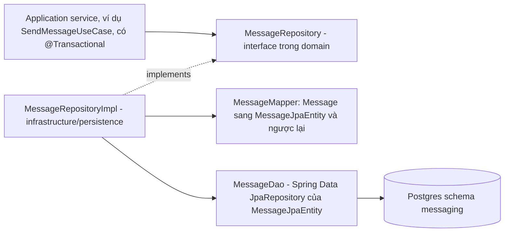

# Cấu trúc backend

File này mô tả build Maven multi-module, cấu trúc package DDD trong mỗi service, module dùng chung, vị trí proto/sinh code, Dockerfile và luật tránh coupling.

## 1. Build tool: Maven multi-module (P-03, [ADR-006](../00-overview/adr/ADR-006-build-tool.md))

| Module | `artifactId` | Phụ thuộc |
|-------|--------------|-----------|
| Parent | `nexus-backend` | BOM: Spring Boot 4.1.x, Spring Cloud (bản tương thích Boot 4.1, xác nhận ở P2), Spring gRPC, gRPC, Testcontainers |
| `proto` | `nexus-proto` | grpc-protobuf, grpc-stub |
| `libs/nexus-common-web` | | spring-boot-starter-web, security |
| `libs/nexus-common-messaging` | | spring-boot-starter-amqp, data-jpa |
| `libs/nexus-common-grpc` | | `nexus-proto`, spring-grpc |
| `libs/nexus-test-support` | | testcontainers (scope test) |
| `services/*`, `gateways/*` | `<tên>` | các module trên tùy nhu cầu |

Lệnh thường dùng:

| Mục đích | Lệnh |
|---------|------|
| Build + test một service (kèm module phụ thuộc) | `./mvnw -pl services/messaging-service -am verify` |
| Chỉ sinh code proto | `./mvnw -pl proto generate-sources` |
| Format | `./mvnw spotless:apply` |
| Chạy local ngoài Docker | `./mvnw -pl services/identity-service spring-boot:run -Dspring-boot.run.profiles=local` |

## 2. Proto và sinh code

- Nguồn: `proto/src/main/proto/nexus/<context>/v1/*.proto` ([grpc-design.md](../02-architecture/grpc-design.md#2-vị-trí-proto-và-sinh-code)).
- Plugin `io.github.ascopes:protobuf-maven-plugin` trong `proto/pom.xml`, phase `generate-sources`, sinh message + stub gRPC vào `proto/target/generated-sources/`.
- Service dùng: dependency `com.nexus:nexus-proto`. IDE nhận code sinh sau `./mvnw -pl proto install`.
- Không commit code sinh; CI luôn sinh lại (`-am` kéo theo `proto`).

## 3. Cấu trúc package mỗi service (ví dụ messaging-service)

```text
services/messaging-service/
├── Dockerfile
├── pom.xml
└── src/
    ├── main/java/com/nexus/messaging/
    │   ├── MessagingApplication.java
    │   ├── domain/                        # THUẦN JAVA: không Spring, không JPA annotation, không proto
    │   │   ├── message/                   # Message (aggregate root), Attachment, MessageContent (VO), MessageRepository (interface), MessageCreated...
    │   │   ├── reaction/                  # Reaction, Emoji (VO), ReactionRepository
    │   │   ├── channel/                   # ChannelRef, ChannelKind, ChannelRefRepository
    │   │   ├── social/                    # FriendRequest, Friendship, DmChannel, UserPair (VO), DmAccessPolicy
    │   │   └── shared/                    # MediaRef, DomainEvent, AggregateRoot base
    │   ├── application/
    │   │   ├── message/                   # SendMessageUseCase, EditMessageUseCase, GetHistoryQuery...
    │   │   ├── social/                    # SendFriendRequestUseCase, OpenDmUseCase...
    │   │   └── port/                      # ChannelPermissionChecker, UserDirectory, UploadSigner, DomainEventPublisher
    │   ├── infrastructure/
    │   │   ├── persistence/               # Lớp DAO (ADR-009): domain không biết gì về thư mục này
    │   │   │   ├── message/               # MessageJpaEntity, AttachmentJpaEntity, MessageDao, MessageMapper, MessageRepositoryImpl
    │   │   │   ├── reaction/              # ReactionJpaEntity, ReactionDao, ReactionMapper, ReactionRepositoryImpl
    │   │   │   ├── channel/               # ChannelRefJpaEntity, ChannelRefDao, ChannelRefMapper, ChannelRefRepositoryImpl
    │   │   │   └── social/                # FriendRequestJpaEntity, FriendRequestDao, ... *RepositoryImpl
    │   │   ├── grpc/                      # CommunityPermissionClient, IdentityUserClient (Resilience4j, deadline)
    │   │   ├── cache/                     # RedisChannelPermissionCache
    │   │   ├── messaging/                 # cấu hình exchange/queue/binding của service
    │   │   └── cloudinary/                # CloudinaryUploadSigner (ACL)
    │   └── interfaces/
    │       ├── rest/                      # Controller + request/response DTO + validation
    │       ├── grpc/                      # ChannelAccessGrpcService (server adapter)
    │       └── messaging/                 # CommunityEventsListener + DTO consumer (tolerant reader)
    ├── main/resources/
    │   ├── application.yml, application-local.yml
    │   └── db/migration/V1__init.sql ...
    └── test/java/com/nexus/messaging/
        ├── domain/                        # unit test thuần
        ├── application/                   # unit test với port giả
        ├── infrastructure/                # Testcontainers: Postgres, RabbitMQ, Redis; grpc in-process
        ├── interfaces/                    # @WebMvcTest, contract test event
        └── ArchitectureTest.java          # ArchUnit
```

| Lớp | Được phụ thuộc vào | Không được phụ thuộc vào |
|-----|-------------------|--------------------------|
| `domain` | JDK | Spring, JPA, `com.nexus.proto`, các lớp khác |
| `application` | `domain` | `infrastructure`, `interfaces`, `com.nexus.proto` (Spring `@Transactional` cho phép) |
| `infrastructure` | `domain`, `application`, framework | `interfaces` |
| `interfaces` | `application`, `domain` (đọc) | `infrastructure` |

Luật trên được ArchUnit kiểm tra trong mọi service (NFR-041).

Kiểu Java theo lớp (đã chốt P-33, không Lombok — [ADR-008](../00-overview/adr/ADR-008-no-lombok.md)):

| Loại | Dạng Java |
|------|----------|
| Value object, payload domain event | `record` có kiểm tra trong compact constructor |
| Aggregate root, entity domain | `final class`, constructor + getter viết tay, không setter; factory method `create(...)` và method nghiệp vụ |
| Persistence entity `XxxJpaEntity` (`infrastructure/persistence`) | class viết tay có annotation JPA, getter/setter cho JPA; **không** ra khỏi `infrastructure` |
| `XxxMapper` | `final class` với 2 method tĩnh/instance `toDomain(...)`, `toJpa(...)` viết tay |
| REST DTO, DTO consumer event, DTO gRPC adapter | `record` |

### 3.1 Lớp persistence: Repository → RepositoryImpl → DAO (ADR-009, người dùng đã chọn)



| Thành phần | Tên | Nằm ở | Làm gì | Biết gì |
|-----------|-----|-------|--------|---------|
| Repository (interface) | `XxxRepository` | `domain/<module>/` | Lưu/lấy **aggregate** bằng ngôn ngữ nghiệp vụ: `save(Message)`, `findById(MessageId)`, `findHistory(channelId, before, limit)` | Chỉ kiểu domain |
| RepositoryImpl | `XxxRepositoryImpl` | `infrastructure/persistence/<module>/` | Hiện thực interface: gọi DAO, dùng mapper | Domain + DAO + JPA entity |
| DAO | `XxxDao` | `infrastructure/persistence/<module>/` | Truy cập dữ liệu: `interface MessageDao extends JpaRepository<MessageJpaEntity, UUID>` + query method / `@Query` / `JdbcClient` cho SQL đặc thù (`ON CONFLICT`, keyset) | Chỉ JPA entity và bảng |
| Persistence entity | `XxxJpaEntity` | `infrastructure/persistence/<module>/` | Ánh xạ bảng (`@Entity`, `@Table`, `@Version`) | Không biết domain |
| Mapper | `XxxMapper` | `infrastructure/persistence/<module>/` | Chuyển `XxxJpaEntity` ↔ aggregate (tái tạo aggregate qua factory `Message.rehydrate(...)`, không qua setter) | Cả hai phía |

**Quy tắc:**
- `domain` không import DAO, JPA entity, `jakarta.persistence`, Spring Data (ArchUnit cưỡng chế).
- `application` chỉ dùng `XxxRepository` (interface domain), **không** gọi DAO trực tiếp.
- **Transaction** đặt ở application service (`@Transactional` trên method use case): một use case = một transaction, gồm lưu aggregate + ghi outbox. RepositoryImpl/DAO không tự mở transaction mới.
- Mỗi aggregate một Repository; entity con (`Attachment`) không có Repository/DAO công khai riêng — được lưu qua `MessageRepositoryImpl` (DAO con nếu cần là chi tiết nội bộ).
- Projection (`channel_refs`, `channel_activity`) cũng đi qua Repository + RepositoryImpl + DAO như aggregate.
- **Outbox/inbox cũng đi qua DAO:** `libs/nexus-common-messaging` có `OutboxEventJpaEntity` + `OutboxEventDao` (dùng bởi `OutboxWriter` và `OutboxRelay`) và `ProcessedEventJpaEntity` + `ProcessedEventDao` (dùng bởi `InboxGuard`). Đây là hạ tầng kỹ thuật, không phải aggregate, nên không có Repository domain; `DomainEventPublisher` (port ở `application`) được hiện thực bằng `OutboxWriter` → `OutboxEventDao`.

**Test:**

| Đối tượng | Kiểu test | Cần DB? |
|----------|-----------|---------|
| Aggregate, VO, domain service | Unit test thuần | Không |
| Application service | Unit test, mock `XxxRepository` (interface domain) và port | Không |
| `XxxMapper` | Unit test round-trip: aggregate → JPA entity → aggregate bằng nhau | Không |
| `XxxDao`, `XxxRepositoryImpl` | Integration test Testcontainers Postgres + Flyway thật (`@DataJpaTest` + `@AutoConfigureTestDatabase(replace = NONE)` hoặc `@SpringBootTest`) | Có |
| `OutboxEventDao`, `ProcessedEventDao` | Integration test trong `libs/nexus-common-messaging` | Có |

## 4. Khái niệm DDD bằng ví dụ trong Nexus

| Khái niệm | Định nghĩa ngắn | Ví dụ Nexus |
|----------|-----------------|-------------|
| Entity | Có danh tính (id) xuyên suốt vòng đời, thuộc tính đổi được | `Role` (đổi tên vẫn là role đó) |
| Value object | Không danh tính, so sánh theo giá trị, bất biến, tự validate | `Email`, `ChannelName`, `PermissionSet`, `MediaRef` |
| Aggregate | Cụm entity/VO đổi cùng nhau trong 1 transaction, có một **root** bảo vệ bất biến | `Message` + `Attachment`: không thể thêm attachment thứ 6 vì root kiểm tra |
| Aggregate root | Cửa duy nhất để sửa aggregate | `FriendRequest.accept(actorId)` kiểm tra actor là addressee và trạng thái `PENDING` |
| Domain event | Điều nghiệp vụ đã xảy ra | `MemberJoined` do `Member` sinh ra khi join |
| Repository | Interface lưu/lấy **aggregate** (không phải bảng) | `MessageRepository.save(Message)`; hiện thực `MessageRepositoryImpl` dùng `MessageDao` + `MessageMapper` ở `infrastructure` (mục 3.1) |
| Domain service | Logic không thuộc riêng aggregate nào | `PermissionCalculator` cần `Member`, `Role`, `Channel` |
| Application service / use case | Điều phối: load aggregate, gọi domain, lưu, phát event; không chứa luật nghiệp vụ | `SendMessageUseCase` |

## 5. Module dùng chung và tránh coupling

| Nên ở `libs/` | Không được ở `libs/` |
|--------------|---------------------|
| Envelope event, outbox/inbox (kèm `OutboxEventDao`, `ProcessedEventDao`), cấu hình RabbitMQ chung | Class payload event nghiệp vụ dùng chung (mỗi consumer tự định nghĩa DTO) |
| Problem Details, exception handler | Entity, value object nghiệp vụ |
| gRPC interceptor (JWT, MDC) | Logic quyền |
| Base test Testcontainers | Hằng số nghiệp vụ |

Nguyên tắc: sửa `libs/` làm build lại mọi service → giữ `libs/` nhỏ và ổn định.

## 6. Dockerfile mỗi service (ADR-007)

Vị trí: `services/<svc>/Dockerfile`, `gateways/<gw>/Dockerfile`; build từ gốc repo: `docker build -f services/messaging-service/Dockerfile .`.

```dockerfile
# syntax=docker/dockerfile:1.7
FROM maven:3.9-eclipse-temurin-21 AS build
WORKDIR /src
COPY pom.xml mvnw ./
COPY .mvn .mvn
COPY proto/pom.xml proto/
COPY libs/ libs/
COPY services/messaging-service/pom.xml services/messaging-service/
RUN --mount=type=cache,target=/root/.m2 ./mvnw -q -pl services/messaging-service -am dependency:go-offline
COPY proto/ proto/
COPY services/messaging-service/ services/messaging-service/
RUN --mount=type=cache,target=/root/.m2 ./mvnw -q -pl services/messaging-service -am package -DskipTests

FROM eclipse-temurin:21-jre-alpine AS extract
WORKDIR /x
COPY --from=build /src/services/messaging-service/target/*.jar app.jar
RUN java -Djarmode=tools -jar app.jar extract --layers --launcher --destination out

FROM eclipse-temurin:21-jre-alpine
RUN addgroup -S app && adduser -S -u 10001 -G app app
WORKDIR /app
COPY --from=extract /x/out/dependencies/ ./
COPY --from=extract /x/out/spring-boot-loader/ ./
COPY --from=extract /x/out/snapshot-dependencies/ ./
COPY --from=extract /x/out/application/ ./
USER 10001
ENV JAVA_TOOL_OPTIONS="-XX:MaxRAMPercentage=75 -XX:+ExitOnOutOfMemoryError"
EXPOSE 8083 9093
HEALTHCHECK --interval=10s --timeout=3s --start-period=40s --retries=5 \
  CMD wget -qO- http://localhost:8183/actuator/health/readiness || exit 1
ENTRYPOINT ["java", "org.springframework.boot.loader.launch.JarLauncher"]
```

Cổng quản trị (actuator) = cổng HTTP + 100 (ví dụ 8183), không publish ra host. Layer cache: POM và dependency được copy trước source → sửa code chỉ chạy lại 2 bước cuối của stage build và chỉ thay layer `application`.
