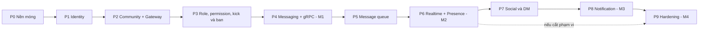

# Roadmap

File này chia dự án thành các phase theo thứ tự phụ thuộc, mỗi phase kết thúc ở trạng thái **demo được**, kèm tiêu chí hoàn thành và độ lớn tương đối (S/M/L — độ phức tạp, không phải thời gian; dự án không có deadline). Checklist chi tiết: [backend-plan.md](backend-plan.md), [frontend-plan.md](frontend-plan.md), [devops-plan.md](devops-plan.md). Khái niệm học mỗi phase: [learning-path.md](learning-path.md).

## 1. Nguyên tắc

1. **Dễ trước, khó sau; bước nhỏ, mỗi bước chạy và kiểm tra được.**
2. **Một service chạy trọn vòng** (domain, REST, Postgres, Flyway, Dockerfile, CI) trước khi thêm service thứ hai; rồi mới gRPC; rồi mới message queue.
3. **Mỗi phase kết thúc bằng một demo** chạy bằng `docker compose up -d --build` + tag git `v0.<phase>.0`. Không có phase "làm dở".
4. **Bản chạy end-to-end sớm** (M1 ở cuối P4), mở rộng sau.
5. Backend-first (P-30): frontend chỉ thêm đủ trang để demo phase đó.

## 2. Tổng quan phase

| Phase | Tên | Phụ thuộc | Service mới | FR chính | Độ lớn | Demo cuối phase |
|-------|-----|-----------|-------------|---------|--------|-----------------|
| P0 | Nền móng | - | (hạ tầng) | - | S | `docker compose up` → Postgres/Redis/RabbitMQ healthy; CI xanh; `messaging_svc` không đọc được schema `community` |
| P1 | Identity trọn vòng | P0 | identity | FR-001..FR-004, FR-006..FR-008, FR-010, FR-100, FR-102 | M | Đăng ký, đăng nhập, refresh, sửa profile, đổi avatar qua trang web; image trên GHCR |
| P2 | Community core + API Gateway | P1 | community, api-gateway | FR-020..FR-031 | M | Tạo server, category, kênh, invite; người thứ hai join bằng link; mọi request qua gateway :8080 |
| P3 | Role, permission & kick/ban | P2 | - | FR-032..FR-034, FR-036, FR-037, FR-039 | M | Tạo role, gán role, khóa kênh `announcements` chỉ Mod gửi được; Mod kick một member, ban một member kèm lý do → người đó join lại bị `403 BANNED_FROM_SERVER`, gỡ ban → join được. Kick/ban đặt **sau** phần role/permission vì cần `RoleHierarchyPolicy` |
| P4 | Messaging + **gRPC** | P3 | messaging | FR-050..FR-055, FR-058, FR-059 (lưu), FR-101 | L | **M1 – Walking skeleton:** chat trong kênh (frontend poll 3 s), reply, reaction, đính kèm; tắt community → gửi tin trả 503 nhanh |
| P5 | **Message queue** | P4 | - | (hạ tầng event cho mọi FR) | L | RabbitMQ UI thấy event chạy; xóa kênh → Messaging từ chối gửi; gửi event trùng không gây lỗi; message lỗi vào DLQ |
| P6 | Realtime + Presence | P5 | realtime-gateway, presence | FR-056, FR-057, FR-080, FR-081, FR-083 (phần người chung server) | L | **M2 – Chat realtime MVP:** 2 trình duyệt chat realtime, typing, online/offline chỉ hiện với người chung server (người lạ không thấy); chạy 2 instance realtime-gateway |
| P7 | Social & DM | P6 | - (module social trong messaging) | FR-070..FR-076, FR-080/FR-083 (phần bạn bè) | M | Kết bạn, nhận lời mời realtime, DM 1-1; bạn bè không chung server vẫn thấy online, hủy kết bạn → hết thấy |
| P8 | Notification | P7 | notification | FR-090..FR-093, FR-059 (đếm) | M | **M3 – MVP đầy đủ:** kênh in đậm khi có tin mới, badge mention, đồng bộ đã đọc giữa 2 tab |
| P9 | Hardening & portfolio | P8 (hoặc P6 nếu cắt phạm vi) | - | NFR | M | **M4 – Sẵn sàng CV:** dashboard Grafana, k6 có số liệu, e2e trong CI, README hoàn chỉnh, demo công khai |

## 3. Tiêu chí hoàn thành chung cho mọi phase (Definition of Done)

- [ ] Mọi FR của phase có test tự động (unit + ít nhất 1 integration cho luồng chính).
- [ ] CI xanh cho mọi workflow bị ảnh hưởng; image mới trên GHCR.
- [ ] `docker compose down -v && docker compose up -d --build` từ máy sạch chạy được demo của phase.
- [ ] Tài liệu liên quan cập nhật (event-catalog, grpc-design, data-model nếu đổi).
- [ ] Ghi 3-5 dòng "đã học được gì" vào `docs/journal.md` (tư liệu cho phỏng vấn).
- [ ] Tag `v0.<phase>.0`.

## 4. Mốc (milestone)

| Mốc | Sau phase | Ý nghĩa |
|-----|----------|---------|
| M1 Walking skeleton | P4 | Luồng đăng nhập → server → chat đi qua 3 service, gateway, gRPC. Đã có thứ để cho người khác xem |
| M2 Chat realtime MVP | P6 | Đủ "xương sống" microservice: REST + gRPC + event + WebSocket. **Mức tối thiểu đáng đưa vào CV** (sau khi làm P9 rút gọn) |
| M3 MVP đầy đủ | P8 | Mọi FR MVP |
| M4 Sẵn sàng CV | P9 | Đạt [portfolio-readiness.md](portfolio-readiness.md) |

## 5. Cắt phạm vi khi quá tải

Thứ tự **giữ** (không cắt): P0 → P6 + phần "observability + README + test CI" của P9. Thứ tự **cắt/hoãn** nếu cần: (1) FR-058 đính kèm trong P4 (giữ avatar), (2) P8 Notification, (3) P7 Social & DM, (4) demo công khai, (5) k6 ws-fanout. Chi tiết: [risks-and-open-questions.md](risks-and-open-questions.md#2-rủi-ro-làm-quá-nhiều-không-xong).

## 6. Tiêu chí "sẵn sàng đưa vào CV"

- [ ] README gốc `nexus-backend` có: sơ đồ kiến trúc, bảng "dùng gRPC ở đâu / event ở đâu", chạy bằng **một lệnh** `docker compose up -d --build`, badge CI, GIF demo.
- [ ] Ít nhất M2 hoàn thành và chạy ổn định từ máy sạch (gồm kick/ban của P3).
- [ ] Có integration test chứng minh: người lạ không thấy presence (NFR-018); người bị ban không join lại được, kể cả khi ban và join chạy đồng thời.
- [ ] CI: build + test (unit, Testcontainers, ArchUnit) + image + Trivy cho mọi service, xanh trên `main`.
- [ ] Coverage `domain` + `application` ≥ 70%.
- [ ] Một trace end-to-end "gửi tin nhắn" chụp màn hình từ Grafana Tempo trong README.
- [ ] Kết quả k6 thật (p95, throughput, cấu hình máy) trong `docs/perf/`.
- [ ] ADR cho các quyết định chính (`docs/00-overview/adr/`).
- [ ] OpenAPI truy cập được qua gateway.
- [ ] (Khuyến nghị) Demo công khai hoặc video 2-3 phút.
- [ ] Gạch đầu dòng CV chỉ ghi điều dự án **thật sự** làm được ([portfolio-readiness.md](portfolio-readiness.md#3-trình-bày-trong-cv)).
